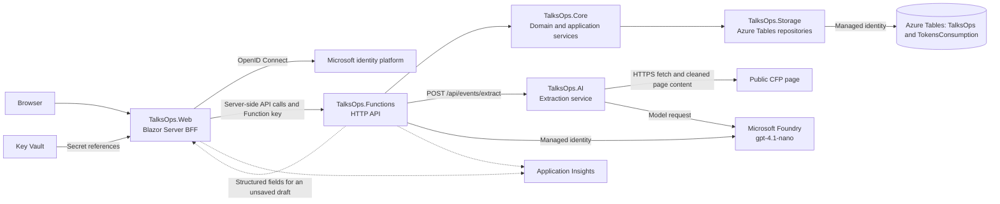

TalksOps is a .NET 10 application for managing speaking events, session proposals, and an annual calendar. Its six projects separate the domain and services, Azure Tables persistence, the REST client and Functions API, the AI extraction implementation, and the server-side Blazor application.

## Features

- Manage events with dates, location, official and call-for-papers URLs, CFP deadlines, and named costs.
- Track session proposals per event, including abstracts, notes, submission dates, and lifecycle status.
- View events and proposal status in an annual calendar, with on-demand event and proposal details.
- Import and export events and proposals as version 1 JSON without event or session IDs, including in the downloadable template. Exports can be date-filtered; imports are additive and generate new IDs for records assigned to the current user. Older files containing IDs remain supported; those IDs are ignored.
- Optionally extract event details from a public call-for-papers page. The AI-assisted workflow fetches and cleans the page, asks a Microsoft Foundry model for structured event fields, and opens an editable, unsaved draft. The user reviews and saves it through the normal event workflow. Extraction is disabled by default and requires both UI enablement and backend Foundry configuration; requests are rate-limited per user and Function App instance.

## Documentation

- [Source code guide and class diagrams](src/README.md)
- [Infrastructure, architecture, and provisioning guide](infra/README.md)
- [Core domain and business services](src/TalksOps.Core/README.md)
- [AI event extraction](src/TalksOps.AI/README.md)
- [REST contracts and HTTP client](src/TalksOps.ApiClient/README.md)
- [Azure Tables persistence](src/TalksOps.Storage/README.md)
- [Functions API](src/TalksOps.Functions/README.md)
- [Blazor Server web application](src/TalksOps.Web/README.md)

## Deploy with Azure Developer CLI

Install the latest stable version of the [Azure Developer CLI (`azd`)](https://learn.microsoft.com/azure/developer/azure-developer-cli/install-azd) before deploying. The latest stable release is **1.35.1** (checked October 13, 2026); this repository does not pin a minimum version. Confirm the installed version with `azd version`. You also need the .NET 10 SDK, Azure CLI, and Bicep CLI; see the [infrastructure guide](infra/README.md) for Azure permissions and other prerequisites.

Sign in, create an AZD environment, and set its required values. `AZURE_ENV_NAME` is set by `azd env new`; the deployment identity must be allowed to create role assignments.

```powershell
az login
azd auth login
azd env new talksops-dev
azd env set AZURE_PROJECT_NAME talksops-dev
azd env set AZURE_SUBSCRIPTION_ID <subscription-id>
azd env set AZURE_LOCATION <azure-region>
```

Required environment values are `AZURE_ENV_NAME` (created with the environment), `AZURE_PROJECT_NAME`, `AZURE_SUBSCRIPTION_ID`, `AZURE_LOCATION`, and `AZURE_PRINCIPAL_ID` (the deployment identity's object ID).

Provision the Azure resources and deploy both services with `azd up`. For subsequent code-only updates, use `azd deploy`:

```powershell
azd up -e talksops-dev
azd deploy -e talksops-dev
```

> [!NOTE]
> If you receive an error during `azd up` related to a resource that already exists, try again the command


To remove the environment, including its Azure resources and tenant app registration, run:

```powershell
azd down -e talksops-dev
```

This teardown deletes the provisioned data as well. Review the target subscription and data-retention requirements first. For the full deployment lifecycle, hook behavior, and required permissions, see the [infrastructure guide](infra/README.md).

## Architecture



The Web app is the authenticated backend-for-frontend: it keeps the Function key server-side and derives the user ID from the signed-in principal. The Functions API handles event, proposal, calendar, and import/export requests through Core services; Storage repositories persist application data in Azure Tables. For AI extraction, the API delegates to the separate `TalksOps.AI` project, which retrieves a public CFP page and calls the configured Foundry deployment. Extracted fields return to the Web app as a draft and are not persisted until the user saves the event. Successful model calls also write token usage metadata to the separate `TokensConsumption` table; this telemetry is best effort and never blocks extraction.

## Functions API security and configuration

All HTTP-triggered Functions require a Function key. Keep the key in server-side web configuration or Key Vault; never send it to browser code or publish it as an infrastructure output. Configure the Functions host with `StorageUri` set to the Azure Table service endpoint, `StorageTableName` for events and proposals, and `StorageTokensConsumptionTableName` for token usage (defaults to `TokensConsumption`). The Function App uses its managed identity through `DefaultAzureCredential` to access both tables. Events and session proposals share `TalksOps`: events use `events|{ownerId}` partition keys, and session proposals use `sessions|{eventId}` partition keys, where `eventId` is a GUID formatted as 32 hexadecimal digits without hyphens. Token records are stored separately in `TokensConsumption`, partitioned by escaped user ID and keyed by a unique GUID.

### Local Functions development

Install Azure Functions Core Tools v4 and Azurite, then start Azurite with its Blob, Queue, and Table services enabled. The Functions project's `local.settings.json` uses these values:

```json
{
	"IsEncrypted": false,
	"Values": {
		"AzureWebJobsStorage": "UseDevelopmentStorage=true",
		"FUNCTIONS_WORKER_RUNTIME": "dotnet-isolated",
		"StorageTableName": "TalksOps",
		"StorageTokensConsumptionTableName": "TokensConsumption",
		"StorageConnectionString": "UseDevelopmentStorage=true"
	}
}
```

From `src/TalksOps.Functions`, run `dotnet run`. When `StorageConnectionString` is configured, the application uses shared-key authentication and creates both application tables if they do not exist. Azurite must be running before the Functions start. The standard development connection string uses the Table endpoint at `http://127.0.0.1:10002/devstoreaccount1`; use a custom connection string if your emulator has different endpoints.

Each `TokensConsumption` row records the user ID, UTC model-call timestamp, deployment name, optional input/output token counts, and CFP URL. A successful Foundry response is recorded before parsing, so malformed model output still has usage telemetry. A persistence failure is logged and extraction continues; failed model calls do not create a record.

`StorageConnectionString` takes precedence over `StorageUri`. Leave it unset in Azure to retain `DefaultAzureCredential` authentication. Do not commit connection strings containing real account keys.

The API receives the user owner key in its request envelope or query string (the member remains named `UserId`). The authenticated Blazor Server application populates it from the signed-in principal's login username (`preferred_username`, then `upn`/mapped UPN), trimmed and lowercased, never from editable form data or a display name. Events use `events|{username}` with reserved table-key characters escaped. Existing subject-based data requires [migration](src/TalksOps.Storage/README.md#username-ownership-migration). Usernames can change or be reassigned and are not necessarily unique across tenants/providers; this scheme requires a trusted, unique, non-recycled username namespace. Use an account mapping based on `(tid, oid)` when immutable tenant-scoped ownership is required. The Function key is a shared application credential, not per-user authentication: anyone who obtains it can submit a different user owner key and potentially act as that user. Stronger caller identity binding requires API token validation or another per-user authentication mechanism.
