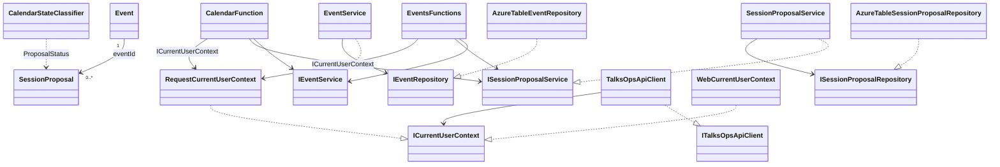

# Source code guide

`src` contains the six .NET 10 projects that implement TalksOps: domain and application services, AI event extraction, Azure Tables persistence, an HTTP Functions API, a typed API client, and a server-side Blazor web application.

## Project map

| Project | Responsibility | Detailed documentation |
| --- | --- | --- |
| `TalksOps.Core` | Domain records, validation, service and repository contracts, and owner-scoped application services. | [TalksOps.Core](TalksOps.Core/README.md) |
| `TalksOps.AI` | Public event-page fetching and cleaning, prompt-based extraction, and Microsoft Foundry integration. | [TalksOps.AI](TalksOps.AI/README.md) |
| `TalksOps.Storage` | Azure Tables implementations of the event and proposal repositories. | [TalksOps.Storage](TalksOps.Storage/README.md) |
| `TalksOps.ApiClient` | REST contracts and the typed HTTP client used by the web application. | [TalksOps.ApiClient](TalksOps.ApiClient/README.md) |
| `TalksOps.Functions` | Function-key-protected HTTP endpoints that call Core services. | [TalksOps.Functions](TalksOps.Functions/README.md) |
| `TalksOps.Web` | Authenticated Blazor Server interface for event, proposal, and calendar workflows. | [TalksOps.Web](TalksOps.Web/README.md) |

## Class diagram

## Cross-project contracts

- `Event` and `SessionProposal` are the domain records. An event can include an optional `CallForPapersDeadline`; a proposal references its parent event through `EventId`, and `ProposalStatus` represents its lifecycle.
- `IEventService` and `ISessionProposalService` expose operations for the current user. Their implementations replace caller-supplied ownership with `ICurrentUserContext.UserId` before persistence.
- `IEventRepository` and `ISessionProposalRepository` separate application behavior from persistence. `TalksOps.Storage` provides their Azure Tables implementations.
- `ITalksOpsApiClient` is the Web-to-Functions boundary. Its DTOs and request records live in `TalksOps.ApiClient.Contracts` and are intentionally separate from Core domain records.
- The Web identity context derives the user ID from the signed-in principal; the Functions request context is initialized per invocation from the API request envelope or query string. A Function key is an application credential and does not independently bind a request to a user.

## Import and export

The authenticated Web app provides an **Import / Export** page for moving events and their session proposals as a JSON file. Event data includes named costs; session data includes its status, timestamps, and optional submission date. Neither exports nor the **Download JSON template** file contain event or session IDs. Export can be filtered by optional `from` and `to` dates; it includes events whose date range overlaps the requested range. Import accepts TalksOps export documents up to 10 MB and is additive: it creates new event and session IDs, assigns all imported records to the current user, and leaves existing data unchanged. Older version 1 documents containing IDs or missing a session submission date or event costs remain valid; any supplied IDs are ignored. The complete import is validated before any records are written.

The Functions API exposes the corresponding export and import operations. For the JSON schema, status values, and a complete sample document, see [Import and export in TalksOps.Core](TalksOps.Core/README.md#import-and-export) and [`example-export.json`](TalksOps.Core/Export/example-export.json).

## Local development

See [TalksOps.Functions](TalksOps.Functions/README.md) for the local API and Azurite setup, and [TalksOps.Web](TalksOps.Web/README.md) for Web authentication and startup. The Web API base address must match the Functions host URL. Infrastructure provisioning and Azure deployment are documented in [infra/README.md](../infra/README.md).
