# Source code guide

`src` contains the six .NET 10 projects that implement TalksOps: domain and application services, AI event extraction, Azure Tables persistence, an HTTP Functions API, a typed API client, and a server-side Blazor web application. Together they support event/proposal workflows and public participant feedback.

## Project map

| Project | Responsibility | Detailed documentation |
| --- | --- | --- |
| `TalksOps.Core` | Domain records, validation, service and repository contracts, and owner-scoped application services. | [TalksOps.Core](TalksOps.Core/README.md) |
| `TalksOps.AI` | Public event-page fetching and cleaning, prompt-based extraction, and Microsoft Foundry integration. | [TalksOps.AI](TalksOps.AI/README.md) |
| `TalksOps.Storage` | Azure Tables implementations for events, proposals, token usage, and session feedback. | [TalksOps.Storage](TalksOps.Storage/README.md) |
| `TalksOps.ApiClient` | REST contracts and the typed HTTP client used by the web application. | [TalksOps.ApiClient](TalksOps.ApiClient/README.md) |
| `TalksOps.Functions` | HTTP endpoints that call Core services; speaker routes use Function keys and participant feedback routes are anonymous. | [TalksOps.Functions](TalksOps.Functions/README.md) |
| `TalksOps.Web` | Authenticated Blazor Server interface for event, proposal, calendar, and feedback management, plus the anonymous participant feedback page. | [TalksOps.Web](TalksOps.Web/README.md) |

## Class diagram

```mermaid
classDiagram
    class Event
    class SessionProposal
    class EventService
    class SessionProposalService
    class IEventService
    class ISessionProposalService
    class IEventRepository
    class ISessionProposalRepository
    class AzureTableEventRepository
    class AzureTableSessionProposalRepository
    class EventsFunctions
    class CalendarFunction
    class ITalksOpsApiClient
    class TalksOpsApiClient
    class ICurrentUserContext
    class WebCurrentUserContext
    class RequestCurrentUserContext
    class CalendarStateClassifier
    class FeedbackFunctions
    class IFeedbackService
    class AzureTableStorageFeedbackService
    class SessionFeedback
    class FeedbackSettings

    Event "1" --> "0..*" SessionProposal : eventId
    EventService ..|> IEventService
    SessionProposalService ..|> ISessionProposalService
    EventService --> IEventRepository
    SessionProposalService --> ISessionProposalRepository
    AzureTableEventRepository ..|> IEventRepository
    AzureTableSessionProposalRepository ..|> ISessionProposalRepository
    EventsFunctions --> IEventService
    EventsFunctions --> ISessionProposalService
    CalendarFunction --> IEventService
    CalendarFunction --> ISessionProposalService
    TalksOpsApiClient ..|> ITalksOpsApiClient
    TalksOpsApiClient --> ICurrentUserContext
    WebCurrentUserContext ..|> ICurrentUserContext
    RequestCurrentUserContext ..|> ICurrentUserContext
    EventsFunctions --> RequestCurrentUserContext : ICurrentUserContext
    CalendarFunction --> RequestCurrentUserContext : ICurrentUserContext
    CalendarStateClassifier ..> SessionProposal : ProposalStatus
    FeedbackFunctions --> IFeedbackService
    AzureTableStorageFeedbackService ..|> IFeedbackService
    AzureTableStorageFeedbackService ..> SessionFeedback
    AzureTableStorageFeedbackService ..> FeedbackSettings
```

## Cross-project contracts

- `Event` and `SessionProposal` are the domain records. An event can include an optional `CallForPapersDeadline`; a proposal references its parent event through `EventId`, carries an optional submission date, and uses `ProposalStatus` for its lifecycle.
- `IEventService` and `ISessionProposalService` expose operations for the current user. Their implementations replace caller-supplied ownership with `ICurrentUserContext.UserId` before persistence.
- `IEventRepository` and `ISessionProposalRepository` separate application behavior from persistence. `TalksOps.Storage` provides their Azure Tables implementations.
- `ITalksOpsApiClient` is the Web-to-Functions boundary. Its DTOs and request records live in `TalksOps.ApiClient.Contracts` and are intentionally separate from Core domain records.
- `IFeedbackService` stores session feedback settings and submissions; the speaker-facing settings/summary routes verify session ownership, while the public participant routes expose only a session title and availability.
- The Web identity context derives the user ID from the signed-in principal; the Functions request context is initialized per invocation from the API request envelope or query string. A Function key is an application credential and does not independently bind a request to a user.

## Import and export

The authenticated Web app provides an **Import / Export** page for moving events, session proposals, feedback settings, and received feedback as a JSON file. Event data includes named costs; session data includes its status, timestamps, and optional submission date. Feedback exports include ratings, comment, timestamp, and the settings' validity interval/time zone, but omit IDs, internal references, and request metadata. Neither exports nor the **Download JSON template** file contain event, session, or feedback IDs. Export can be filtered by optional `from` and `to` dates; it includes events whose date range overlaps the requested range. Import accepts TalksOps export documents up to 10 MB and is additive: it creates new IDs, assigns all imported records to the current user, and leaves existing data unchanged. Older version 1 documents containing IDs or missing a session submission date or event costs remain valid; any supplied IDs are ignored. The complete import is validated before any records are written.

The Functions API exposes the corresponding export and import operations. For the JSON schema, status values, and a complete sample document, see [Import and export in TalksOps.Core](TalksOps.Core/README.md#import-and-export) and [`example-export.json`](TalksOps.Core/Export/example-export.json).

### Feedback for an existing session

The session feedback management page also provides **Export Feedback** and **Import Feedback**, independently of the event-level transfer page. Export produces a plain JSON array of `sessionRating`, `speakerRating`, `comment`, and `timestamp`, without IDs or request metadata. Import accepts the same array from a file up to 10 MB and appends entries to the selected, ownership-checked session. Supplied timestamps are preserved; missing or null timestamps use the server's UTC import time. Existing feedback and collection settings remain unchanged, and import works outside the collection period or without configured settings. Reimporting a file adds duplicates.

The Web page refreshes the feedback list, count, and rating averages after import. The client uses `ImportFeedbackEntryDto` and `ImportFeedbackResultDto` with `POST /api/events/{eventId}/proposals/{proposalId}/feedback/import`; persistence reuses `IFeedbackService.ImportSessionAsync` with null settings. See the [Web workflow](TalksOps.Web/README.md#session-feedback-management) and [feedback import API](TalksOps.Functions/README.md#import-feedback).

## Local development

See [TalksOps.Functions](TalksOps.Functions/README.md) for the local API and Azurite setup, and [TalksOps.Web](TalksOps.Web/README.md) for Web authentication and startup. The Web API base address must match the Functions host URL. Infrastructure provisioning and Azure deployment are documented in [infra/README.md](../infra/README.md).
