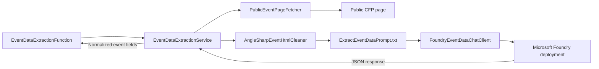

# TalksOps.AI

`TalksOps.AI` is a .NET 10 class library that implements the event-extraction contracts defined in `TalksOps.Core`. It fetches a public call-for-papers page, prepares bounded model input, calls a Microsoft Foundry deployment, and returns normalized event fields. It does not persist events; the Web application presents the result as an editable draft, which is saved through the normal event API only after user confirmation.

## Extraction flow



1. `PublicEventPageFetcher` retrieves the submitted URL after validating the URL, DNS results, and every redirect.
2. `AngleSharpEventHtmlCleaner` parses the HTML and builds concise input from page metadata, JSON-LD event data, relevant links, and visible content.
3. `EventDataExtractionService` loads the prompt, inserts the source URL and cleaned content, and calls `IEventDataChatClient`.
4. The service parses the JSON response, trims text, validates URLs, normalizes dates to `DD/MM/YYYY`, and returns `ExtractedEventData`.

## Main types

| Type | Responsibility |
| --- | --- |
| `EventDataExtractionService` | Orchestrates fetch, clean, prompt construction, model completion, response parsing, and normalization. Implements Core's `IEventDataExtractionService`. |
| `PublicEventPageFetcher` | Fetches bounded HTML from public HTTP(S) addresses. Disables automatic redirects and validates redirect targets. |
| `AngleSharpEventHtmlCleaner` | Uses AngleSharp's HTML parser to extract bounded, relevant page content and resolve useful links against the source URL. |
| `FoundryEventDataChatClient` | Calls a named Foundry project deployment using Microsoft Entra authentication through `DefaultAzureCredential`, with JSON response mode. |
| `PromptProvider` | Loads `PromptFiles/ExtractEventDataPrompt.txt` from the application output directory. |
| `EventDataExtractionException` / `EventDataExtractionErrorCode` | Represents expected failures with a stable category for the Functions API to map to an HTTP response. |

## Project structure

| Folder | Contents |
| --- | --- |
| `Services/` | Event extraction orchestration, public event-page fetching, and HTML cleaning. |
| `Providers/` | Foundry chat client and prompt-file provider. |
| Project root | Shared extraction exception and error-code types. |

The service depends on `IEventPageFetcher`, `IEventHtmlCleaner`, and `IEventDataChatClient` from Core. Extraction request and response records are also defined in Core (`ExtractedEventData` and `EventDataModelResponse`), keeping this implementation independent of the HTTP and persistence layers.

## Input and output

The prompt asks the model to return only fields supported by the supplied page and to use `null` for values that cannot be reliably determined. The response contains these nullable fields:

- `Name` and `Location`
- `OfficialWebsiteUrl` and `CallForPapersUrl`
- `CallForPapersDeadline`, `StartDate`, and `EndDate`

Dates are returned as `DD/MM/YYYY`. Invalid date values and URLs are normalized to `null`; an empty, malformed, or entirely empty model response is rejected rather than returned as event data. Extraction is advisory: callers should let users review the result before saving it.

## Fetching and input limits

The page fetcher accepts absolute HTTP or HTTPS URLs without user information. It requires every DNS result to be public, pins connections to validated public addresses, disables automatic redirects, and validates each redirect target. It allows at most three redirects, has a 15-second fetch timeout, and reads at most 2 MiB of HTML.

The cleaner prefers the `main` or `article` content when available, includes page title and description, canonical URL, JSON-LD, and up to 30 event-relevant links. It removes scripts and non-content elements from visible text and limits the final prompt input to 40,000 characters. The Foundry client requests JSON output and caps model output at 1,200 tokens. Page content is treated as untrusted data, not as model instructions.

Expected failure categories are `InvalidSourceUrl`, `UnsafeSourceAddress`, `FetchFailed`, `TooManyRedirects`, `PageTooLarge`, `InvalidModelResponse`, and `NoEventData`. The Functions endpoint translates these into safe HTTP error responses; unexpected failures are logged without returning internal exception details.

## Configuration and integration

The library is registered by `TalksOps.Functions` only when all three settings are present:

| Setting | Purpose |
| --- | --- |
| `FoundryEndpoint` | HTTPS Foundry resource endpoint, without a project or API path. |
| `FoundryProjectName` | Foundry project used for inference. |
| `FoundryDeploymentName` | Model deployment name. |

The Functions process must be signed in through `DefaultAzureCredential` and have permission to use the deployment (the provisioned Function identity receives the Foundry User role). Do not commit environment-specific endpoints or credentials. If the settings are missing, the API returns HTTP 503 and reports that extraction is not configured.

The Web visibility switch is separate: `Features:AiExtraction` defaults to `false` and must be enabled to show the extraction action. The Functions API also applies an in-memory per-user rate limit, defaulting to one request per 60-second window per Function App instance. See [TalksOps.Functions configuration](../TalksOps.Functions/README.md), [TalksOps.Web configuration](../TalksOps.Web/README.md), and the [infrastructure guide](../../infra/README.md) for deployment settings and role assignments.

## Dependencies and tests

The project references `TalksOps.Core` and uses AngleSharp for HTML parsing, Azure Identity for Entra authentication, and the OpenAI .NET client for Foundry chat completions. Its focused unit tests cover prompt substitution, date normalization, and invalid or empty model output:

```powershell
dotnet test tests/TalksOps.AI.Tests/TalksOps.AI.Tests.csproj
```
