# TalksOps.ApiClient

`TalksOps.ApiClient` defines the JSON request/response contracts shared by the Web and Functions projects and implements a typed `HttpClient` for the TalksOps REST API. It uses `ICurrentUserContext` to include the current user identifier in speaker requests; the Web application supplies that context from the authenticated principal. Public feedback methods do not access that context.

## Class diagram

```mermaid
classDiagram
    class ITalksOpsApiClient {
        <<interface>>
        +SearchEventsAsync(request, cancellationToken)
        +GetEventAsync(eventId, cancellationToken)
        +CreateEventAsync(request, cancellationToken)
        +UpdateEventAsync(eventId, request, cancellationToken)
        +DeleteEventAsync(eventId, cancellationToken)
        +ListProposalsAsync(eventId, cancellationToken)
        +GetProposalAsync(eventId, proposalId, cancellationToken)
        +CreateProposalAsync(eventId, request, cancellationToken)
        +UpdateProposalAsync(eventId, proposalId, request, cancellationToken)
        +ChangeProposalStatusAsync(eventId, proposalId, request, cancellationToken)
        +DeleteProposalAsync(eventId, proposalId, cancellationToken)
        +GetCalendarAsync(year, cancellationToken)
        +GetFeedbackSettingsAsync(eventId, proposalId, cancellationToken)
        +SaveFeedbackSettingsAsync(eventId, proposalId, request, cancellationToken)
        +ListFeedbackAsync(eventId, proposalId, cancellationToken)
        +GetPublicFeedbackAsync(sessionId, cancellationToken)
        +SubmitFeedbackAsync(sessionId, request, cancellationToken)
    }
    class TalksOpsApiClient
    class ICurrentUserContext {
        <<interface>>
        +string UserId
    }
    class ApiRequest~T~ {
        +string UserId
        +T Payload
    }
    class EventDto
    class SessionProposalDto
    class CalendarEventDto
    class EventSearchRequest
    class SaveEventRequest
    class SaveSessionProposalRequest
    class ChangeProposalStatusRequest
    class FeedbackSettingsDto
    class SaveFeedbackSettingsRequest
    class SessionFeedbackDto
    class FeedbackMetadataDto
    class PublicFeedbackDto
    class SubmitFeedbackRequest
    class ExtractEventDataRequest
    class ExtractEventDataResultDto
    class ApiErrorDto
    class PagedResponse~T~
    class ApiRequestExtensions {
        +WithUserId(path, userId)$ string
    }

    TalksOpsApiClient ..|> ITalksOpsApiClient
    TalksOpsApiClient --> ICurrentUserContext
    TalksOpsApiClient ..> ApiRequest
    TalksOpsApiClient ..> EventDto
    TalksOpsApiClient ..> SessionProposalDto
    TalksOpsApiClient ..> CalendarEventDto
    TalksOpsApiClient ..> EventSearchRequest
    TalksOpsApiClient ..> SaveEventRequest
    TalksOpsApiClient ..> SaveSessionProposalRequest
    TalksOpsApiClient ..> ChangeProposalStatusRequest
    TalksOpsApiClient ..> FeedbackSettingsDto
    TalksOpsApiClient ..> SaveFeedbackSettingsRequest
    TalksOpsApiClient ..> SessionFeedbackDto
    TalksOpsApiClient ..> PublicFeedbackDto
    TalksOpsApiClient ..> SubmitFeedbackRequest
    SessionFeedbackDto ..> FeedbackMetadataDto
    TalksOpsApiClient ..> ExtractEventDataRequest
    TalksOpsApiClient ..> ExtractEventDataResultDto
    TalksOpsApiClient ..> PagedResponse
    ApiRequestExtensions ..> ICurrentUserContext
```

## Types and members

Records below expose positional properties with the listed names and types; records have no additional methods unless specified.

| Type | Properties / purpose |
| --- | --- |
| `ApiRequest<T>` | `UserId: string`, `Payload: T`. Envelope used for POST, PUT, and PATCH requests. |
| `EventDto` | `Id: Guid`, `OwnerId: string`, `Name: string`, `Location: string`, `StartDate: DateOnly`, `EndDate: DateOnly`, `Costs: IReadOnlyDictionary<string, decimal>`, `OfficialWebsiteUrl: string?`, `CallForPapersUrl: string?`, `CallForPapersDeadline: DateOnly?`. |
| `SessionProposalDto` | `Id: Guid`, `EventId: Guid`, `OwnerId: string`, `Title: string`, `Abstract: string`, `Notes: string`, `Status: ProposalStatus`, `CreatedAt: DateTimeOffset`, `UpdatedAt: DateTimeOffset`, `SubmissionDate: DateOnly?`. |
| `CalendarEventDto` | `EventId: Guid`, `EventName: string`, `StartDate: DateOnly`, `EndDate: DateOnly`, `ProposalStatuses: IReadOnlyList<string>`, `OfficialWebsiteUrl: string?`, `CallForPapersUrl: string?`, `CallForPapersDeadline: DateOnly?`. |
| `EventSearchRequest` | `Year: int?`, `Name: string?`, `Location: string?`, `Page: int` (default 1), `PageSize: int` (default 20). |
| `SaveEventRequest` | `Name: string`, `Location: string`, `StartDate: DateOnly`, `EndDate: DateOnly`, `Costs: IReadOnlyDictionary<string, decimal>`, `OfficialWebsiteUrl: string?`, `CallForPapersUrl: string?`, `CallForPapersDeadline: DateOnly?`; fields accepted to create or update an event. |
| `SaveSessionProposalRequest` | `Title: string`, `Abstract: string?`, `Notes: string?`, `SubmissionDate: DateOnly?`; fields accepted to create or update a proposal. |
| `ChangeProposalStatusRequest` | `Status: ProposalStatus`; desired proposal lifecycle state. |
| `ExtractEventDataRequest` | `SourcePageUrl: string?`; URL of the call-for-papers page to analyze. |
| `ExtractEventDataResultDto` | Nullable event fields returned by extraction; date values remain strings in `DD/MM/YYYY` format. |
| `ApiErrorDto` | `Code: string?`, `Message: string?`; structured error returned when extraction fails. |
| `PagedResponse<T>` | `Items: IReadOnlyList<T>`, `Page: int`, `PageSize: int`, `TotalCount: int`. |
| `FeedbackSettingsDto` | `SessionId: Guid`, `ValidFrom: DateTimeOffset`, `ValidTo: DateTimeOffset`, `TimeZoneId: string`; does not expose the internal event reference. |
| `SaveFeedbackSettingsRequest` | `ValidFrom: DateTimeOffset`, `ValidTo: DateTimeOffset`, `TimeZoneId: string`; speaker-supplied feedback period. |
| `SessionFeedbackDto` | `Id`, `SessionId`, `SessionRating`, `SpeakerRating`, optional `Comment`, `Timestamp`, and `Metadata`; returned only to the owning speaker. |
| `FeedbackMetadataDto` | Optional `IpAddress` and `UserAgent`, acquired from the server request. |
| `PublicFeedbackDto` | `EventTitle: string`, `Title: string`, `Available: bool`; event and session titles in the minimal public response while feedback is open. |
| `SubmitFeedbackRequest` | `SessionRating: int`, `SpeakerRating: int`, optional `Comment`; the only participant-supplied fields. |
| `ExtractEventDataAsync(request, cancellationToken)` | Sends the current user's request to `api/events/extract` and returns nullable extracted fields. Structured failure messages are surfaced through `HttpRequestException`. |
| `ITalksOpsApiClient` | Typed API contract; all methods accept optional cancellation tokens. |
| `TalksOpsApiClient` | HTTP implementation; requires `HttpClient` and `ICurrentUserContext`. Optional GET methods return `null` on HTTP 404. Other non-success responses throw through `EnsureSuccessStatusCode`; required response bodies must not be empty. |
| `ApiRequestExtensions.WithUserId` | Internal extension that URL-escapes `userId` and appends it using `?` or `&`, depending on the existing path. |

### `ITalksOpsApiClient` methods

| Method | Behavior |
| --- | --- |
| `SearchEventsAsync(request, cancellationToken)` | Searches and returns paged event DTOs. |
| `GetEventAsync(eventId, cancellationToken)` | Gets an event or returns `null` when absent. |
| `CreateEventAsync(request, cancellationToken)` / `UpdateEventAsync(eventId, request, cancellationToken)` | Creates or updates an event. |
| `DeleteEventAsync(eventId, cancellationToken)` | Deletes an event and its proposals. |
| `ListProposalsAsync(eventId, cancellationToken)` / `GetProposalAsync(eventId, proposalId, cancellationToken)` | Lists proposals or gets one, returning `null` when the latter is absent. |
| `CreateProposalAsync(eventId, request, cancellationToken)` / `UpdateProposalAsync(eventId, proposalId, request, cancellationToken)` | Creates or updates a proposal. |
| `ChangeProposalStatusAsync(eventId, proposalId, request, cancellationToken)` | Changes proposal status using PATCH. |
| `DeleteProposalAsync(eventId, proposalId, cancellationToken)` | Deletes a proposal. |
| `GetCalendarAsync(year, cancellationToken)` | Gets calendar summaries for a year. |
| `ExportEventsAsync(from, to, cancellationToken)` | Gets a version 1 `EventsExportDocument` without event, session, or feedback IDs; includes transferable feedback and validity settings and remains optionally filtered by date. |
| `ImportEventsAsync(document, cancellationToken)` | Imports an `EventsExportDocument` additively and returns event, session, and feedback counts. The server generates new event/session/feedback IDs, rebuilds internal settings references, and ignores IDs in older JSON files. Missing feedback/settings fields remain valid. See the [Core JSON format](../TalksOps.Core/README.md#import-and-export). |

The client sends `userId` in the query for speaker GET/DELETE calls and in the request envelope for speaker writes. Keep this client server-side; the Function key and user ID are not browser credentials.

## Session feedback

| Method | Contract and behavior |
| --- | --- |
| `GetFeedbackSettingsAsync(eventId, proposalId)` | Speaker GET at `api/events/{eventId}/proposals/{proposalId}/feedback/settings` with current `userId`; returns `FeedbackSettingsDto?`, null on 404. |
| `SaveFeedbackSettingsAsync(eventId, proposalId, request)` | Speaker PUT at the settings route with `ApiRequest<SaveFeedbackSettingsRequest>` and current `userId`; returns `FeedbackSettingsDto`. Payload contains only `ValidFrom`, `ValidTo` (`DateTimeOffset`) and `TimeZoneId`. |
| `ListFeedbackAsync(eventId, proposalId)` | Speaker GET at `api/events/{eventId}/proposals/{proposalId}/feedback` with current `userId`; returns newest-first `SessionFeedbackDto` entries including `FeedbackMetadataDto`. |
| `GetPublicFeedbackAsync(sessionId)` | Anonymous GET at `api/feedback/{sessionId}`; never reads `ICurrentUserContext` or adds `userId`; returns `PublicFeedbackDto` (`Title`, `Available`), null on 404. |
| `SubmitFeedbackAsync(sessionId, request)` | Anonymous POST at the public route; sends flat `SubmitFeedbackRequest` JSON containing only `SessionRating`, `SpeakerRating`, `Comment`. Never reads `ICurrentUserContext`, wraps the body in an envelope, or supplies identity/metadata. Accepts empty 201. |

The public GET exposes no internal event reference, owner, settings, or collected metadata. Feedback write failures preserve HTTP status codes (including 400, 404, 413 and 429) in `HttpRequestException.StatusCode`; structured errors also preserve the server message, and an empty 404 is handled without attempting to parse JSON. Malformed JSON error bodies still preserve the HTTP status, with the parsing failure as the inner exception. Speaker reads preserve existing optional-GET and HTTP-error conventions. See the [Functions feedback API](../TalksOps.Functions/README.md#session-feedback-api) for validity, payload limits, ownership and request metadata rules.
