# TalksOps.Core

`TalksOps.Core` contains TalksOps domain records, business rules, application-service contracts (including session feedback), repository contracts, and owner-scoped event and proposal services. It has no dependency on Azure storage or the Web/Functions hosting layers.

## Class diagram

```mermaid
classDiagram
    class Event {
        +Guid Id
        +string OwnerId
        +string Name
        +string Location
        +string? OfficialWebsiteUrl
        +string? CallForPapersUrl
        +DateOnly? CallForPapersDeadline
        +DateOnly StartDate
        +DateOnly EndDate
        +IReadOnlyDictionary Costs
    }
    class SessionProposal {
        +Guid Id
        +Guid EventId
        +string OwnerId
        +string Title
        +string Abstract
        +string Notes
        +DateOnly? SubmissionDate
        +ProposalStatus Status
        +DateTimeOffset CreatedAt
        +DateTimeOffset UpdatedAt
    }
    class TokensConsumption {
        +string UserId
        +DateTimeOffset Timestamp
        +string DeploymentName
        +int? InputTokens
        +int? OutputTokens
        +string CallForPapersUrl
    }
    class ProposalStatus {
        <<enumeration>>
        Submitted
        Accepted
        Rejected
        Cancelled
    }
    class EventService
    class SessionProposalService
    class ICurrentUserContext {
        <<interface>>
        +string UserId
    }
    class IEventService {
        <<interface>>
        +SearchAsync(criteria, cancellationToken)
        +GetAsync(eventId, cancellationToken)
        +CreateAsync(value, cancellationToken)
        +UpdateAsync(value, cancellationToken)
        +DeleteAsync(eventId, cancellationToken)
    }
    class ISessionProposalService {
        <<interface>>
        +ListByEventAsync(eventId, cancellationToken)
        +GetAsync(eventId, proposalId, cancellationToken)
        +CreateAsync(proposal, cancellationToken)
        +UpdateAsync(proposal, cancellationToken)
        +ChangeStatusAsync(eventId, proposalId, status, cancellationToken)
        +CancelAsync(eventId, proposalId, cancellationToken)
        +DeleteAsync(eventId, proposalId, cancellationToken)
    }
    class IEventRepository {
        <<interface>>
        +SearchAsync(ownerId, criteria, cancellationToken)
        +GetAsync(ownerId, eventId, cancellationToken)
        +CreateAsync(value, cancellationToken)
        +UpdateAsync(value, cancellationToken)
        +DeleteAsync(ownerId, eventId, cancellationToken)
    }
    class ISessionProposalRepository {
        <<interface>>
        +ListByEventAsync(ownerId, eventId, cancellationToken)
        +GetAsync(ownerId, eventId, proposalId, cancellationToken)
        +CreateAsync(proposal, cancellationToken)
        +UpdateAsync(proposal, cancellationToken)
        +DeleteAsync(ownerId, eventId, proposalId, cancellationToken)
    }
    class ITokensConsumptionRepository {
        <<interface>>
        +CreateAsync(value, cancellationToken)
    }
    class IFeedbackService {
        <<interface>>
        +GetSessionTitleAsync(sessionId, cancellationToken)
        +GetSettingsAsync(sessionId, cancellationToken)
        +SaveSettingsAsync(settings, cancellationToken)
        +ListBySessionAsync(sessionId, cancellationToken)
        +CreateAsync(sessionId, submission, metadata, cancellationToken)
        +ImportSessionAsync(sessionId, settings, feedback, cancellationToken)
    }
    class EventSearchCriteria {
        +int? Year
        +string? Name
        +string? Location
        +int Page
        +int PageSize
    }
    class PagedResult~T~ {
        +IReadOnlyList Items
        +int Page
        +int PageSize
        +int TotalCount
    }
    class EventRules {
        +Validate(value)$ IReadOnlyList~string~
    }
    class SessionProposalRules {
        +Validate(value)$ IReadOnlyList~string~
        +CanTransition(current, target)$ bool
    }
    class FeedbackRules {
        +Validate(settings)$ IReadOnlyList~string~
        +ValidateSubmission(submission)$ IReadOnlyList~string~
        +ValidateImportedFeedback(feedback)$ IReadOnlyList~string~
    }

    Event "1" --> "0..*" SessionProposal : EventId
    SessionProposal --> ProposalStatus
    SessionProposal ..> FeedbackSettings : SessionId
    SessionProposal ..> SessionFeedback : SessionId
    IFeedbackService ..> FeedbackSettings
    IFeedbackService ..> SessionFeedback
    IFeedbackService ..> SessionFeedbackSubmission
    IFeedbackService ..> SessionFeedbackMetadata
    IFeedbackService ..> SessionFeedbackImport
    IFeedbackService ..> FeedbackRules
    ITokensConsumptionRepository ..> TokensConsumption
    EventService ..|> IEventService
    SessionProposalService ..|> ISessionProposalService
    EventService --> IEventRepository
    SessionProposalService --> ISessionProposalRepository
    EventService --> ICurrentUserContext
    SessionProposalService --> ICurrentUserContext
    EventService ..> EventRules
    SessionProposalService ..> SessionProposalRules
    IEventService ..> EventSearchCriteria
    IEventService ..> PagedResult
```



## Domain types

### `Event`

Immutable record for an event. `Id` is generated by default; `OwnerId`, `Name`, `Location`, `StartDate`, and `EndDate` are required. `OfficialWebsiteUrl`, `CallForPapersUrl`, and `CallForPapersDeadline` are optional; the deadline is a `DateOnly`. `Costs` is a name-to-decimal dictionary and defaults to empty. It has no methods.

### `SessionProposal`

Immutable record for a proposal attached to `EventId`. `Id` is generated by default; `OwnerId` and `Title` are required. `Abstract` and `Notes` default to empty, `SubmissionDate` is optional, `Status` defaults to `Submitted`, and `CreatedAt`/`UpdatedAt` default to the current UTC time. It has no methods.

### `TokensConsumption`

Immutable record for usage metadata from one completed event-extraction model call. It contains the initiating `UserId`, UTC `Timestamp`, `DeploymentName`, optional `InputTokens` and `OutputTokens` (nullable because the model client may omit usage), and the extraction's `CallForPapersUrl`. These records are persisted separately from events and proposals.

### `ProposalStatus`

Lifecycle values: `Submitted`, `Accepted`, `Rejected`, and `Cancelled`.

### `EventRules`

`Validate(Event value)` returns validation messages for missing owner/name/location, an end date before the start date, a call-for-papers deadline after the event end date, empty cost names, or negative costs. An empty result means valid input.

### `SessionProposalRules`

`Validate(SessionProposal value)` checks the parent event ID, owner, title, and timestamp ordering. `CanTransition(current, target)` accepts defined statuses when the target differs from the current value; it does not encode a stricter status-specific transition graph.

## Contracts and services

| Type | Members and behavior |
| --- | --- |
| `ICurrentUserContext` | `UserId` gets the authenticated/current request user's owner key. The Web application supplies a trimmed, lowercase login username. |
| `EventSearchCriteria` | `Year`, `Name`, and `Location` are optional filters; `Page` defaults to 1 and `PageSize` to 20. |
| `PagedResult<T>` | Positional properties: `Items`, `Page`, `PageSize`, `TotalCount`. |
| `IEventRepository` | Owner-scoped `SearchAsync`, `GetAsync`, `UpdateAsync`, and `DeleteAsync`; `CreateAsync` persists a new event. Delete also removes proposals for the event. All methods accept an optional cancellation token. |
| `IEventService` | `SearchAsync`, `GetAsync`, `CreateAsync`, `UpdateAsync`, and `DeleteAsync` for the current user. Create/update validate and overwrite `OwnerId` using `ICurrentUserContext`. |
| `ISessionProposalRepository` | Owner- and event-scoped `ListByEventAsync`, `GetAsync`, `CreateAsync`, `UpdateAsync`, and `DeleteAsync`; methods accept an optional cancellation token. |
| `ISessionProposalService` | `ListByEventAsync`, `GetAsync`, `CreateAsync`, `UpdateAsync`, `ChangeStatusAsync`, `CancelAsync`, and `DeleteAsync` for the current user. Updates preserve server-owned identity and timestamps; status changes update `UpdatedAt`. |
| `ITokensConsumptionRepository` | `CreateAsync` persists a completed extraction's `TokensConsumption` metadata; token counts may be absent. |
| `EventService` | Implements `IEventService`; constructor dependencies are `IEventRepository` and `ICurrentUserContext`. Validation failures throw `ArgumentException`. |
| `SessionProposalService` | Implements `ISessionProposalService`; constructor dependencies are `ISessionProposalRepository` and `ICurrentUserContext`. Invalid status changes throw `InvalidOperationException`; validation failures throw `ArgumentException`. |

All asynchronous service and repository methods accept an optional `CancellationToken`. Nullable return values from get/update operations indicate that the requested record was not found or is not owned by the caller.

## Session feedback

| Type | Members and behavior |
| --- | --- |
| `FeedbackSettings` | `SessionId`, internal `EventId`, inclusive `ValidFrom`, exclusive `ValidTo`, and required `TimeZoneId`. The event reference supports public title lookup and is not part of the public API DTO. |
| `SessionFeedback` | Server-created feedback record with `Id`, `SessionId`, integer session/speaker ratings, optional `Comment`, UTC `Timestamp`, and required `Metadata`. |
| `SessionFeedbackSubmission` | Participant-supplied ratings and optional comment only; IDs, timestamp, and metadata are server-owned. |
| `SessionFeedbackMetadata` | Optional request `IpAddress` and `UserAgent` captured by the Functions layer. |
| `SessionFeedbackImport` | Transferable ratings, optional comment, and resolved timestamp; excludes IDs and request metadata. For session-level imports, the API preserves supplied timestamps or fills missing/null values before calling persistence. |
| `IFeedbackService` | Provides title lookup, settings read/save, newest-first feedback listing, server-timestamped submission creation, and additive `ImportSessionAsync(sessionId, settings, feedback)`. Import generates new feedback IDs and preserves resolved timestamps; null settings leave existing settings unchanged, allowing import into an existing session. |
| `FeedbackRules` | Validates non-empty session IDs, ordered settings periods and a non-empty time-zone ID; both ratings must be 1–10, comments at most 4000 characters, and imported timestamps non-default. |

The session management page's **Export Feedback** and **Import Feedback** transfer a plain array of ratings, comment, and timestamp for one existing session, independently of event-level import/export. The ownership-checked Functions endpoint assigns its current UTC time to missing/null timestamps before constructing `SessionFeedbackImport`; Core validation still requires a resolved, non-default timestamp. Existing feedback and collection settings remain unchanged, and importing the same file again adds entries with new IDs. See the [feedback import API](../TalksOps.Functions/README.md#import-feedback) for the request format and the [Web workflow](../TalksOps.Web/README.md#session-feedback-management).

## AI event extraction

The extraction contracts live in `Contracts`, while the data types exchanged by those contracts live in `Extraction`. This keeps the application boundary in Core and lets the AI implementation and Functions layer depend on shared contracts without Core depending on AI libraries.

| Type | Members and behavior |
| --- | --- |
| `IEventPageFetcher` | `FetchAsync` downloads page HTML from a public HTTP(S) URL. |
| `IEventHtmlCleaner` | `Clean` converts page HTML into concise model input and resolves links against the source URI. |
| `IEventDataChatClient` | Exposes `DeploymentName` and `CompleteAsync`, which returns model content with input/output token usage metadata. |
| `IEventDataExtractionService` | `ExtractAsync` fetches and extracts event details for a source URL and user ID. |
| `EventDataModelResponse` | Model content, deployment name, and optional input/output token counts returned by a chat client. |
| `ExtractedEventData` | Optional event name, location, website and CFP URLs, CFP deadline, and start/end dates. |

After a successful model call, the extraction service records its deployment, token counts, user ID, and source CFP URL before parsing the response. This also retains usage when the response is malformed. Recording is best effort: persistence errors are logged and do not prevent extraction from continuing; model-call failures are not recorded.

The interfaces and records are in the `TalksOps.Core.Contracts` and `TalksOps.Core.Extraction` namespaces respectively. Their asynchronous methods support cancellation through an optional `CancellationToken`.

## Import and export

`IEventImportExportService` exports the current user's events, sessions, feedback settings, and received feedback as JSON. Each event contains `name`, `location`, optional website and call-for-papers URLs/deadline, `startDate`, `endDate`, named decimal `costs`, and `sessions`. Each session contains `title`, `abstract`, `notes`, optional `submissionDate` (`yyyy-MM-dd`), `status`, `createdAt`, and `updatedAt`; statuses are serialized by name. Sessions also have optional `feedbackSettings` (`validFrom`, `validTo`, and `timeZoneId`) and a `feedback` array containing only `sessionRating`, `speakerRating`, `comment`, and the original `timestamp`. Event, session and feedback IDs, the settings' internal event reference, and all request metadata (including IP and user-agent) are omitted. Optional `from` and `to` dates in the document are inclusive and select events whose date range overlaps the requested range; feedback and settings are included only for those sessions. The document remains schema version `1`. Missing feedback/settings fields are valid for legacy version 1 documents. Older documents containing `id` fields remain supported; those fields are ignored. Import is additive: events, sessions and feedback get new IDs, settings and feedback are attached to the new session, and all imported data is assigned to the current user. Settings preserve their interval and time zone; feedback preserves its votes, comment and timestamp and is stored without request metadata. See [`Export/example-export.json`](Export/example-export.json) for a complete example of the current format.

```json
{
    "schemaVersion": 1,
    "exportedAt": "2026-10-09T10:00:00+00:00",
    "from": "2026-01-01",
    "to": null,
    "events": [
        {
            "name": "Cloud Native Days",
            "location": "Milan, Italy",
            "officialWebsiteUrl": "https://example.org/cloud-native-days",
            "callForPapersUrl": "https://example.org/cloud-native-days/cfp",
            "callForPapersDeadline": "2026-06-30",
            "startDate": "2026-10-20",
            "endDate": "2026-10-21",
            "costs": {
                "travel": 180.00,
                "hotel": 320.00
            },
            "sessions": [
                {
                    "title": "Reliable event-driven systems",
                    "abstract": "Patterns for building resilient event-driven applications.",
                    "notes": "Bring a demo.",
                    "submissionDate": "2026-06-15",
                    "status": "Accepted",
                    "createdAt": "2026-06-01T09:30:00+00:00",
                    "updatedAt": "2026-07-15T14:00:00+00:00",
                    "feedbackSettings": {
                        "validFrom": "2026-10-20T08:00:00+00:00",
                        "validTo": "2026-10-22T08:00:00+00:00",
                        "timeZoneId": "Europe/Rome"
                    },
                    "feedback": [
                        {
                            "sessionRating": 8,
                            "speakerRating": 9,
                            "comment": "Clear and engaging.",
                            "timestamp": "2026-10-20T10:30:00+00:00"
                        }
                    ]
                }
            ]
        }
    ]
}
```
