# TalksOps.Functions

`TalksOps.Functions` is the .NET 10 isolated-worker HTTP API. It validates incoming request shapes, initializes a per-invocation user context for speaker operations, delegates business rules to `TalksOps.Core`, and maps domain records to `TalksOps.ApiClient` contracts. HTTP triggers use Function-level authorization except the anonymous participant feedback endpoints.

## Class diagram

```mermaid
classDiagram
    class EventsFunctions {
        +SearchEvents(request, cancellationToken)
        +GetEvent(request, eventId, cancellationToken)
        +CreateEvent(request, cancellationToken)
        +UpdateEvent(request, eventId, cancellationToken)
        +DeleteEvent(request, eventId, cancellationToken)
        +ListProposals(request, eventId, cancellationToken)
        +GetProposal(request, eventId, proposalId, cancellationToken)
        +CreateProposal(request, eventId, cancellationToken)
        +UpdateProposal(request, eventId, proposalId, cancellationToken)
        +ChangeProposalStatus(request, eventId, proposalId, cancellationToken)
        +DeleteProposal(request, eventId, proposalId, cancellationToken)
    }
    class CalendarFunction {
        +GetCalendar(request, cancellationToken)
    }
    class FeedbackFunctions {
        +GetFeedbackSettings(request, eventId, proposalId, cancellationToken)
        +SaveFeedbackSettings(request, eventId, proposalId, cancellationToken)
        +ListFeedback(request, eventId, proposalId, cancellationToken)
        +GetPublicFeedback(request, sessionId, cancellationToken)
        +SubmitFeedback(request, sessionId, cancellationToken)
    }
    class RequestCurrentUserContext {
        +string UserId
        +TryInitialize(value) bool
    }
    class ICurrentUserContext {
        <<interface>>
        +string UserId
    }
    class IEventService {
        <<interface>>
    }
    class ISessionProposalService {
        <<interface>>
    }
    class IFeedbackService {
        <<interface>>
    }
    class EventService
    class SessionProposalService
    class IEventRepository
    class ISessionProposalRepository
    class ITokensConsumptionRepository
    class AzureTableEventRepository
    class AzureTableSessionProposalRepository
    class AzureTableTokensConsumptionRepository
    class FeedbackService
    class ApiRequest~T~
    class EventDto
    class SessionProposalDto
    class CalendarEventDto
    class FeedbackSettingsDto
    class SessionFeedbackDto
    class PublicFeedbackDto
    class SubmitFeedbackRequest

    RequestCurrentUserContext ..|> ICurrentUserContext
    EventsFunctions --> RequestCurrentUserContext
    CalendarFunction --> RequestCurrentUserContext
    FeedbackFunctions --> RequestCurrentUserContext
    EventsFunctions --> IEventService
    EventsFunctions --> ISessionProposalService
    CalendarFunction --> IEventService
    CalendarFunction --> ISessionProposalService
    FeedbackFunctions --> IFeedbackService
    FeedbackFunctions --> IEventService : ownership check
    FeedbackFunctions --> ISessionProposalService : ownership check
    EventService ..|> IEventService
    SessionProposalService ..|> ISessionProposalService
    EventService --> IEventRepository
    SessionProposalService --> ISessionProposalRepository
    AzureTableEventRepository ..|> IEventRepository
    AzureTableSessionProposalRepository ..|> ISessionProposalRepository
    AzureTableTokensConsumptionRepository ..|> ITokensConsumptionRepository
    FeedbackService ..|> IFeedbackService
    EventsFunctions ..> ApiRequest : request envelope
    EventsFunctions ..> EventDto : response
    EventsFunctions ..> SessionProposalDto : response
    CalendarFunction ..> CalendarEventDto : response
    FeedbackFunctions ..> FeedbackSettingsDto : speaker response
    FeedbackFunctions ..> SessionFeedbackDto : speaker response
    FeedbackFunctions ..> PublicFeedbackDto : anonymous response
    FeedbackFunctions ..> SubmitFeedbackRequest : anonymous request
```



## Classes and members

| Type | Members and behavior |
| --- | --- |
| `EventsFunctions` | Constructor injects `IEventService`, `ISessionProposalService`, and `RequestCurrentUserContext`. Public trigger methods: `SearchEvents`, `GetEvent`, `CreateEvent`, `UpdateEvent`, `DeleteEvent`, `ListProposals`, `GetProposal`, `CreateProposal`, `UpdateProposal`, `ChangeProposalStatus`, and `DeleteProposal`. They implement event/proposal search and CRUD plus status changes. Event request/response mapping includes the optional `CallForPapersDeadline`. Private helpers parse request envelopes and query integers, initialize query/body user IDs, convert request DTOs to domain records and domain records to DTOs, and create 400/409 results. |
| `CalendarFunction` | Injects the event/proposal services and request context. `GetCalendar` validates `userId` and year, pages through all matching events, and returns each event with its proposal status list. |
| `FeedbackFunctions` | Implements speaker-owned settings read/save and feedback listing, verifying event/proposal ownership through Core services. Its anonymous participant endpoints expose only the title while available and accept ratings/comment; they derive metadata from the request and apply a separate in-memory IP limiter. |
| `RequestCurrentUserContext` | Scoped implementation of `ICurrentUserContext`. `TryInitialize(string? value)` trims and stores a non-empty value; `UserId` throws `InvalidOperationException` until initialized. It has no public setter property. |
| `Program` (top-level statements) | Configures the isolated Functions worker, Application Insights, scoped Core services, feedback service and user context, plus Storage registrations and a separate anonymous feedback limiter. It requires `StorageTableName`; `StorageTokensConsumptionTableName` defaults to `TokensConsumption` and `StorageFeedbackTableName` to `SessionsFeedback`. A configured `StorageConnectionString` takes precedence over `StorageUri`. With a connection string, it creates all three tables if absent. |

There are no additional public data properties on the endpoint classes. Request/response records, including `ApiRequest<T>`, `EventDto`, `SessionProposalDto`, and `CalendarEventDto`, are documented in [TalksOps.ApiClient](../TalksOps.ApiClient/README.md).

## HTTP endpoints

The default Functions route prefix is `/api`. Every trigger in the following table requires Function-level authorization and therefore a Function key when the host enforces keys.

| Method and route | Purpose |
| --- | --- |
| `GET /api/events` | Search by optional `year`, `name`, `location`, `page`, and `pageSize`; returns `PagedResponse<EventDto>`. |
| `GET /api/events/{eventId}` | Get an event; returns 404 if absent. |
| `POST /api/events` | Create an event from an `ApiRequest<SaveEventRequest>` envelope. |
| `PUT /api/events/{eventId}` | Update an event. |
| `DELETE /api/events/{eventId}` | Delete an event and its proposals. |
| `GET /api/events/{eventId}/proposals` | List proposals for an owned event. |
| `GET /api/events/{eventId}/proposals/{proposalId}` | Get a proposal. |
| `POST /api/events/{eventId}/proposals` | Create a proposal from an `ApiRequest<SaveSessionProposalRequest>` envelope. |
| `PUT /api/events/{eventId}/proposals/{proposalId}` | Update proposal fields. |
| `PATCH /api/events/{eventId}/proposals/{proposalId}/status` | Change lifecycle status from an `ApiRequest<ChangeProposalStatusRequest>` envelope. |
| `DELETE /api/events/{eventId}/proposals/{proposalId}` | Delete a proposal. |
| `GET /api/calendar?year={year}` | Return calendar events and their proposal statuses for the year. |
| `GET /api/export` | Export events, sessions, feedback settings and feedback as version 1 JSON without internal IDs or request metadata; accepts optional `from` and `to` dates (`yyyy-MM-dd`). |
| `POST /api/import` | Add events, sessions, feedback settings and feedback from an `ApiRequest<EventsExportDocument>` envelope, generating new IDs. Older documents without feedback/settings or containing IDs remain accepted; supplied IDs are ignored. |

GET/DELETE operations take `userId` in the query string; write operations take it in the `ApiRequest<T>` body. The Web application derives this value from the authenticated principal. A Function key is a shared application credential, not user authentication: do not expose it or allow untrusted clients to choose another user's ID.

The import/export JSON format and example are documented in [TalksOps.Core](../TalksOps.Core/README.md#import-and-export).

## Session feedback API

| Method and route | Authorization and response |
| --- | --- |
| `GET /api/events/{eventId}/proposals/{proposalId}/feedback/settings` | Function key and query `userId`; verifies event and proposal ownership, then returns `FeedbackSettingsDto` (200), or 404 when absent/not owned. |
| `PUT /api/events/{eventId}/proposals/{proposalId}/feedback/settings` | Function key and `ApiRequest<SaveFeedbackSettingsRequest>`; verifies ownership before saving, then returns settings (200). Invalid IDs, envelopes or periods return 400; not-owned/missing sessions return 404. |
| `GET /api/events/{eventId}/proposals/{proposalId}/feedback` | Function key and query `userId`; returns owning speaker's newest-first `SessionFeedbackDto[]` (200), including request metadata, or 404. Not restricted by the public validity window. |
| `GET /api/feedback/{sessionId}` | Anonymous, no user context; returns only `{"title":"...","available":true}` (200) during the configured window. |
| `POST /api/feedback/{sessionId}` | Anonymous, flat `SubmitFeedbackRequest` JSON containing only `sessionRating`, `speakerRating`, and optional `comment`; returns 201 with no body. |

Public GET and POST require no Function key, use the UTC server clock with inclusive start and exclusive end, and set `Cache-Control: no-store`. Missing settings, missing sessions/events, invalid session IDs, and closed windows all return an empty 404 without revealing session data. POST rechecks availability after reading and validating the body. Both required ratings must be integers from 1 to 10; missing/out-of-range ratings, malformed JSON, and comments longer than 4000 characters return 400. Bodies larger than 16384 bytes return 413, including requests without a declared content length.

A separate in-memory limiter is shared by public GET and POST: 60 requests per minute per connection IP, per Function App instance; exhaustion returns 429 with `Retry-After`. Scale-out increases the aggregate allowance. Errors with bodies use `ApiErrorDto`; unavailable responses intentionally contain no details.

The public title lookup uses only `sessionId` at its boundary. Settings contain an internal `EventId` reference obtained during the authorized speaker save. Storage uses point reads to verify the session and parent event, without scanning partitions or reading `ICurrentUserContext`. This reference is never exposed in feedback DTOs. Legacy settings without it require an authorized re-save before public use.

IP and user-agent come from `HttpContext.Connection.RemoteIpAddress` and the HTTP `User-Agent` header. Client body fields for identity, IP, user-agent, GUID, timestamp or metadata are ignored. Forwarded headers are not trusted or processed by this feature; behind an unconfigured proxy, the recorded/rate-limited IP is the proxy's. A future trusted-proxy configuration must constrain known proxies before replacing the connection address.

Metadata is collected for feedback abuse diagnostics, stored with the feedback, and accessible only through the owner-checked speaker API. It is potentially personal data, not a participant identity. Retention duration and the participant privacy notice remain release prerequisites to be agreed; this step does not implement automatic retention. Do not expose Function keys in a browser. Speaker requests must originate from the trusted authenticated Web server, as for existing endpoints.

## Local configuration and run

Prerequisites: .NET 10 SDK, Azure Functions Core Tools v4, and Azurite with Blob, Queue, and Table endpoints enabled. The checked-in `local.settings.json` uses the standard local emulator values:

```json
{
  "IsEncrypted": false,
  "Values": {
    "AzureWebJobsStorage": "UseDevelopmentStorage=true",
    "FUNCTIONS_WORKER_RUNTIME": "dotnet-isolated",
    "StorageTableName": "TalksOps",
    "StorageTokensConsumptionTableName": "TokensConsumption",
    "StorageFeedbackTableName": "SessionsFeedback",
    "StorageConnectionString": "UseDevelopmentStorage=true",
    "EventDataExtraction__RateLimit__PermitLimit": "1",
    "EventDataExtraction__RateLimit__WindowSeconds": "60"
  }
}
```

The rate-limit settings are optional and default to one extraction request per user per 60-second window when omitted. `EventDataExtraction__RateLimit__PermitLimit` sets the request count, and `EventDataExtraction__RateLimit__WindowSeconds` sets the window length; both must be positive integers. The limiter is held in memory per Function App instance, so scaling out increases the aggregate allowance.

Event extraction is registered only when all three Foundry settings are present: `FoundryEndpoint` (the HTTPS resource endpoint), `FoundryProjectName`, and `FoundryDeploymentName`. Add them to the local Functions settings to enable extraction locally. The process identity must also be signed in through `DefaultAzureCredential` and authorized to use the Foundry deployment. If these settings are absent, the extraction endpoint returns HTTP 503 with `Event extraction is not configured.` Keep these values environment-specific; do not commit deployment-specific endpoints or credentials.

Start Azurite in one terminal, then run the Functions host from this project directory:

```powershell
azurite
func start --port 7071
```

Azurite's standard Table endpoint is `http://127.0.0.1:10002/devstoreaccount1`. With a local connection string, the application creates `TalksOps`, `TokensConsumption`, and `SessionsFeedback` on startup. `StorageTokensConsumptionTableName` and `StorageFeedbackTableName` can override the dedicated table names; all three names must be distinct. `StorageFeedbackTableName` defaults to `SessionsFeedback` when omitted. Set the Web server's `Feedback:PublicBaseUrl` to the public Web origin locally when testing QR links; it is not needed by Functions. The Web project's development API base address defaults to `http://localhost:7071/`; use the same port or update `TalksOpsApi:BaseAddress`. If your local host uses Function keys, configure the matching key in Web user secrets as `TalksOpsApi:FunctionKey`; leave it empty if the local host accepts requests without a key.

Every successful Foundry call records the user ID, UTC completion timestamp, deployment, available input/output token counts, and source CFP URL in the separate table. The record is written before parsing the model response. Storage failures are logged but do not block the extraction response; failed Foundry calls are not recorded.

`StorageConnectionString` takes precedence over `StorageUri`. For Azure, leave the connection string unset and configure `StorageUri` with the Table service endpoint so `DefaultAzureCredential` is used. Do not put real account keys in source control. See the root [README](../../README.md) and [infrastructure guide](../../infra/README.md) for security boundaries and Azure configuration.
