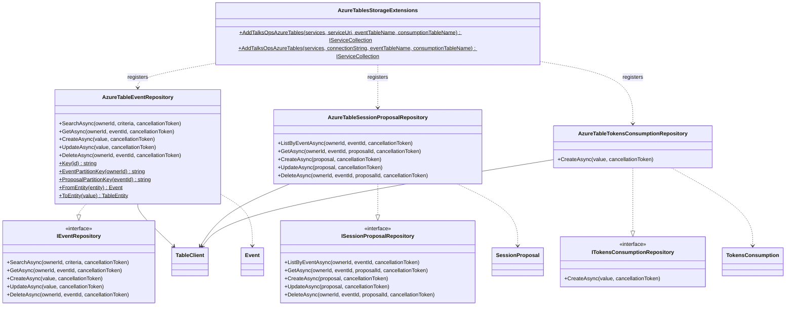

# TalksOps.Storage

`TalksOps.Storage` implements Core repository contracts with Azure Table Storage. Events and session proposals use one configured table and distinct partition-key prefixes; token-consumption records use a separate table. The repositories enforce owner/event scoping when reading and mutating event and proposal records.

## Class diagram

## Classes and methods

| Type | Members and behavior |
| --- | --- |
| `AzureTableEventRepository` | Constructor takes a `TableClient`. Implements `SearchAsync`, `GetAsync`, `CreateAsync`, `UpdateAsync`, and `DeleteAsync` from `IEventRepository`. Search filters by owner, optional year/name/location, sorts by date/name/ID, and clamps page size to 1–100. Delete removes proposals and then the event. |
| `AzureTableSessionProposalRepository` | Constructor takes a `TableClient`. Implements `ListByEventAsync`, `GetAsync`, `CreateAsync`, `UpdateAsync`, and `DeleteAsync` from `ISessionProposalRepository`. It verifies that the owner owns the parent event and filters proposals by owner. |
| `AzureTableTokensConsumptionRepository` | Uses a keyed `TableClient` for the dedicated consumption table. `CreateAsync` stores the UTC timestamp, deployment, optional token counts, and CFP URL. |
| `AzureTablesStorageExtensions` | `AddTalksOpsAzureTables(IServiceCollection, Uri, string, string)` configures `DefaultAzureCredential`; the connection-string overload supports Azurite. Both create distinct table clients for event/proposal and consumption data, and register singleton repositories. |

`AzureTableEventRepository` also provides internal conversion/key helpers: `Key(Guid)` formats IDs using the GUID `N` format; `EventPartitionKey(ownerId)` returns `events|{escapedOwnerId}`; `ProposalPartitionKey(eventId)` returns `sessions|{eventId:N}`; `FromEntity` and `ToEntity` map event records to/from table entities. Proposal entity mapping and parent ownership checks are private to `AzureTableSessionProposalRepository`.

## Table layout

Events and proposals share the `TalksOps` table by default. Event rows use partition key `events|{escapedOwnerId}` and event GUID row keys. The Web application supplies the trimmed, lowercase login username as the owner. Common usernames remain readable (for example, `events|speaker@example.com`); `%`, `/`, `\`, `#`, `?`, and control characters are percent-encoded in the key and decoded when reading the event. A guest UPN such as `speaker#ext#@example.com` therefore uses `events|speaker%23ext%23@example.com`. Encoding `%` prevents collisions with literal escape sequences. Proposal rows use partition key `sessions|{eventId:N}` and proposal GUID row keys; each row also stores the unescaped `OwnerId`. GUIDs use 32 hexadecimal characters without hyphens. See [infra/README.md](../../infra/README.md#application-data-partitions) for migration implications when changing partition prefixes.

Authentication is selected by the registration overload: Azure uses `DefaultAzureCredential` with the table service URI; local development uses the Azurite connection string. The Functions host chooses `StorageConnectionString` when set, otherwise `StorageUri`.

## Token-consumption table

`TokensConsumption` is the default dedicated table name and can be overridden in Functions with `StorageTokensConsumptionTableName`. Each row represents one successful Foundry model call and stores `Timestamp` in UTC, `DeploymentName`, nullable `InputTokens` and `OutputTokens`, and `CallForPapersUrl`. The partition key is the escaped `UserId`; the row key is a unique GUID in `N` format. Reserved characters and control characters are percent-encoded, with `%` encoded as well to prevent key collisions. The table is provisioned independently from `TalksOps`, and the Function identity needs `Storage Table Data Contributor` on both tables.

Consumption recording occurs before model response parsing. If storage is unavailable, the extraction service logs the error and continues returning parsed event data; if the model request fails, no usage row is written.

## Username ownership migration

There is no automatic migration or fallback lookup by the previous subject ID. Existing `events|{sub}` rows are not deleted, but they will not appear when the application requests `events|{username}`. Usernames must be unique within the trusted account namespace and must not be reassigned to another person; changing a username requires another migration.

For an application-level transfer, export all events and proposals to JSON while the previous version is still running, upgrade, sign in again, and import that JSON. Current exports omit event/proposal IDs; older files containing them remain supported and those IDs are ignored. Import assigns the current username to events and proposals and generates new event/proposal IDs. It is additive, so importing the same file twice creates duplicates; the old partition remains untouched.

To preserve event/proposal IDs, perform an administrator-controlled migration with a verified mapping from each old subject ID to its new login username:

1. Back up the table and pause writes for the affected account. Trim the new username and convert it to lowercase invariantly.
2. Copy each event from `events|{oldSubject}` to `events|{escapedUsername}` with the same `RowKey` and properties. Apply the escaping rules above and reject destination conflicts rather than overwriting data. Azure Table partition keys cannot be updated in place.
3. For each copied event, update `OwnerId` from the old subject to the normalized, unescaped username on its `sessions|{eventId:N}` rows. Do not change proposal partition or row keys, and do not update rows belonging to another owner.
4. Verify event and proposal counts, data, and access through the application before removing old event rows and resuming writes. Operations across partitions are not atomic, so keep the backup and migration mapping for recovery.

Legacy owner keys containing literal `%` also need to be re-keyed with percent escaping. Never infer an old-subject-to-username mapping from editable display names or unverified email addresses.
