# TalksOps.Storage

`TalksOps.Storage` implements Core persistence contracts with Azure Table Storage. Events, session proposals, and feedback settings use one configured table and distinct partition-key prefixes; token-consumption records and participant feedback use separate tables. Event and proposal repositories enforce owner/event scoping, while feedback management is scoped by session.

## Class diagram

```mermaid
classDiagram
    class IEventRepository {
        <<interface>>
        +SearchAsync(ownerId, criteria, cancellationToken)
        +GetAsync(ownerId, eventId, cancellationToken)
        +CreateAsync(value, cancellationToken)
        +UpdateAsync(value, cancellationToken)
        +DeleteAsync(ownerId, eventId, cancellationToken)
    }
    class ISessionProposalRepository {
        <<interface>>
        +ListByEventAsync(ownerId, eventId, cancellationToken)
        +GetAsync(ownerId, eventId, proposalId, cancellationToken)
        +CreateAsync(proposal, cancellationToken)
        +UpdateAsync(proposal, cancellationToken)
        +DeleteAsync(ownerId, eventId, proposalId, cancellationToken)
    }
    class ITokensConsumptionRepository {
        <<interface>>
        +CreateAsync(value, cancellationToken)
    }
    class AzureTableEventRepository {
        +SearchAsync(ownerId, criteria, cancellationToken)
        +GetAsync(ownerId, eventId, cancellationToken)
        +CreateAsync(value, cancellationToken)
        +UpdateAsync(value, cancellationToken)
        +DeleteAsync(ownerId, eventId, cancellationToken)
        +Key(id)$ string
        +EventPartitionKey(ownerId)$ string
        +ProposalPartitionKey(eventId)$ string
        +FromEntity(entity)$ Event
        +ToEntity(value)$ TableEntity
    }
    class AzureTableSessionProposalRepository {
        +ListByEventAsync(ownerId, eventId, cancellationToken)
        +GetAsync(ownerId, eventId, proposalId, cancellationToken)
        +CreateAsync(proposal, cancellationToken)
        +UpdateAsync(proposal, cancellationToken)
        +DeleteAsync(ownerId, eventId, proposalId, cancellationToken)
    }
    class AzureTableTokensConsumptionRepository {
        +CreateAsync(value, cancellationToken)
    }
    class AzureTableStorageFeedbackService {
        +GetSessionTitleAsync(sessionId, cancellationToken)
        +GetSettingsAsync(sessionId, cancellationToken)
        +SaveSettingsAsync(settings, cancellationToken)
        +ListBySessionAsync(sessionId, cancellationToken)
        +CreateAsync(sessionId, submission, metadata, cancellationToken)
        +ImportSessionAsync(sessionId, settings, feedback, cancellationToken)
    }
    class AzureTablesStorageExtensions {
        +AddTalksOpsAzureTables(services, serviceUri, eventTableName, consumptionTableName, feedbackTableName)$ IServiceCollection
        +AddTalksOpsAzureTables(services, connectionString, eventTableName, consumptionTableName, feedbackTableName)$ IServiceCollection
    }
    class TableClient

    AzureTableEventRepository ..|> IEventRepository
    AzureTableSessionProposalRepository ..|> ISessionProposalRepository
    AzureTableTokensConsumptionRepository ..|> ITokensConsumptionRepository
    AzureTableStorageFeedbackService ..|> IFeedbackService
    AzureTableEventRepository --> TableClient
    AzureTableSessionProposalRepository --> TableClient
    AzureTableTokensConsumptionRepository --> TableClient
    AzureTableStorageFeedbackService --> TableClient
    AzureTablesStorageExtensions ..> AzureTableEventRepository : registers
    AzureTablesStorageExtensions ..> AzureTableSessionProposalRepository : registers
    AzureTablesStorageExtensions ..> AzureTableTokensConsumptionRepository : registers
    AzureTablesStorageExtensions ..> AzureTableStorageFeedbackService : registers
    AzureTableEventRepository ..> Event
    AzureTableSessionProposalRepository ..> SessionProposal
    AzureTableTokensConsumptionRepository ..> TokensConsumption
```

## Classes and methods

| Type | Members and behavior |
| --- | --- |
| `AzureTableEventRepository` | Constructor takes a `TableClient`. Implements `SearchAsync`, `GetAsync`, `CreateAsync`, `UpdateAsync`, and `DeleteAsync` from `IEventRepository`. Search filters by owner, optional year/name/location, sorts by date/name/ID, and clamps page size to 1–100. Delete removes proposals and then the event. |
| `AzureTableSessionProposalRepository` | Constructor takes a `TableClient`. Implements `ListByEventAsync`, `GetAsync`, `CreateAsync`, `UpdateAsync`, and `DeleteAsync` from `ISessionProposalRepository`. It verifies that the owner owns the parent event and filters proposals by owner. |
| `AzureTableTokensConsumptionRepository` | Uses a keyed `TableClient` for the dedicated consumption table. `CreateAsync` stores the UTC timestamp, deployment, optional token counts, and CFP URL. |
| `AzureTableStorageFeedbackService` | Stores settings in the shared event table and session feedback in a dedicated keyed table. Resolves public session titles with point reads, reads settings by partition/row key, and returns partition-scoped feedback newest-first. Supports server-created submissions and additive import into new or existing sessions with preserved, resolved timestamps. |
| `AzureTablesStorageExtensions` | Both `AddTalksOpsAzureTables` overloads accept the event table name and optional token-consumption and feedback table names. The URI overload configures `DefaultAzureCredential`; the connection-string overload supports Azurite. Both register distinct table clients and persistence services; the Functions host replaces the feedback-service registration with a scoped registration. |

`AzureTableEventRepository` also provides internal conversion/key helpers: `Key(Guid)` formats IDs using the GUID `N` format; `EventPartitionKey(ownerId)` returns `events|{escapedOwnerId}`; `ProposalPartitionKey(eventId)` returns `sessions|{eventId:N}`; `FromEntity` and `ToEntity` map event records to/from table entities. Proposal entity mapping and parent ownership checks are private to `AzureTableSessionProposalRepository`.

## Table layout

Events and proposals share the `TalksOps` table by default. Event rows use partition key `events|{escapedOwnerId}` and event GUID row keys. The Web application supplies the trimmed, lowercase login username as the owner. Common usernames remain readable (for example, `events|speaker@example.com`); `%`, `/`, `\`, `#`, `?`, and control characters are percent-encoded in the key and decoded when reading the event. A guest UPN such as `speaker#ext#@example.com` therefore uses `events|speaker%23ext%23@example.com`. Encoding `%` prevents collisions with literal escape sequences. Proposal rows use partition key `sessions|{eventId:N}` and proposal GUID row keys; each row also stores the unescaped `OwnerId` and optional `SubmissionDate`. GUIDs use 32 hexadecimal characters without hyphens. See [infra/README.md](../../infra/README.md#application-data-partitions) for migration implications when changing partition prefixes.

Authentication is selected by the registration overload: Azure uses `DefaultAzureCredential` with the table service URI; local development uses the Azurite connection string. The Functions host chooses `StorageConnectionString` when set, otherwise `StorageUri`.

## Session-feedback tables

Feedback settings share the `TalksOps` table. Each settings row uses `feedbacksettings|{sessionId:N}` as its partition key and `{sessionId:N}` as its row key; validity instants are stored in UTC and the selected `TimeZoneId` is retained. Feedback rows use the dedicated `SessionsFeedback` table by default, configurable through `StorageFeedbackTableName`. Their partition key is `feedback|{sessionId:N}` and row key is a unique feedback GUID in `N` format. A row stores both ratings, the optional comment, `FeedbackTimestamp` in UTC, and `MetadataJson` containing request IP and user-agent values for submissions. `FeedbackTimestamp` is separate from Azure Table's reserved `Timestamp` property so imports can preserve the original submission instant; reads fall back to the legacy property for existing rows. Feedback reads query only the session partition and sort by timestamp descending.

Settings also retain an internal `EventId` in `N` format, obtained from an ownership-checked speaker request. `GetSessionTitleAsync(sessionId)` resolves the configured session with point reads of its settings, `sessions|{eventId:N}` row, and parent event. It does not depend on the current user and returns only the title, not owner/routing data. Missing settings, missing sessions/events, and legacy settings without an event reference return null; legacy settings need an authorized re-save. The public Functions endpoints apply the validity window separately before exposing this title or accepting a submission.

The `SessionsFeedback` table is kept separate from event and token-consumption tables. The Function identity needs `Storage Table Data Contributor` on this table as well as the existing application tables; the Web identity has no application-table permissions. Table provisioning and local startup configuration are handled by the Functions/infrastructure setup. Event/session import-export transfers only feedback votes, comment and timestamp plus settings interval/time zone; it excludes request metadata and internal IDs/references. Imported feedback receives a new ID and empty request metadata while preserving its timestamp.

The session management page's **Import Feedback** reuses `ImportSessionAsync` with the selected session ID and null settings. This appends rows without replacing existing feedback or updating settings, including when settings do not exist. The Functions layer resolves omitted/null timestamps to its UTC import time before calling storage; supplied timestamps are preserved and normalized to UTC here. Repeated imports generate new IDs and therefore add duplicates. All entries are validated before writes begin, but rows are added individually rather than in a transaction; a storage failure can leave a partial import. No new table, partition scheme, or permission is required. See the [feedback import API](../TalksOps.Functions/README.md#import-feedback).

## Token-consumption table

`TokensConsumption` is the default dedicated table name and can be overridden in Functions with `StorageTokensConsumptionTableName`. Each row represents one successful Foundry model call and stores `Timestamp` in UTC, `DeploymentName`, nullable `InputTokens` and `OutputTokens`, and `CallForPapersUrl`. The partition key is the escaped `UserId`; the row key is a unique GUID in `N` format. Reserved characters and control characters are percent-encoded, with `%` encoded as well to prevent key collisions. The table is provisioned independently from `TalksOps`, and the Function identity needs `Storage Table Data Contributor` on both tables.

Consumption recording occurs before model response parsing. If storage is unavailable, the extraction service logs the error and continues returning parsed event data; if the model request fails, no usage row is written.

## Username ownership migration

There is no automatic migration or fallback lookup by the previous subject ID. Existing `events|{sub}` rows are not deleted, but they will not appear when the application requests `events|{username}`. Usernames must be unique within the trusted account namespace and must not be reassigned to another person; changing a username requires another migration.

For an application-level transfer, export all events and proposals to JSON while the previous version is still running, upgrade, sign in again, and import that JSON. Current exports omit event/proposal IDs; older files containing them remain supported and those IDs are ignored. Import assigns the current username to events and proposals and generates new event/proposal IDs. It is additive, so importing the same file twice creates duplicates; the old partition remains untouched.

To preserve event/proposal IDs, perform an administrator-controlled migration with a verified mapping from each old subject ID to its new login username:

1. Back up the table and pause writes for the affected account. Trim the new username and convert it to lowercase invariantly.
2. Copy each event from `events|{oldSubject}` to `events|{escapedUsername}` with the same `RowKey` and properties. Apply the escaping rules above and reject destination conflicts rather than overwriting data. Azure Table partition keys cannot be updated in place.
3. For each copied event, update `OwnerId` from the old subject to the normalized, unescaped username on its `sessions|{eventId:N}` rows. Do not change proposal partition or row keys, and do not update rows belonging to another owner.
4. Verify event and proposal counts, data, and access through the application before removing old event rows and resuming writes. Operations across partitions are not atomic, so keep the backup and migration mapping for recovery.

Legacy owner keys containing literal `%` also need to be re-keyed with percent escaping. Never infer an old-subject-to-username mapping from editable display names or unverified email addresses.
