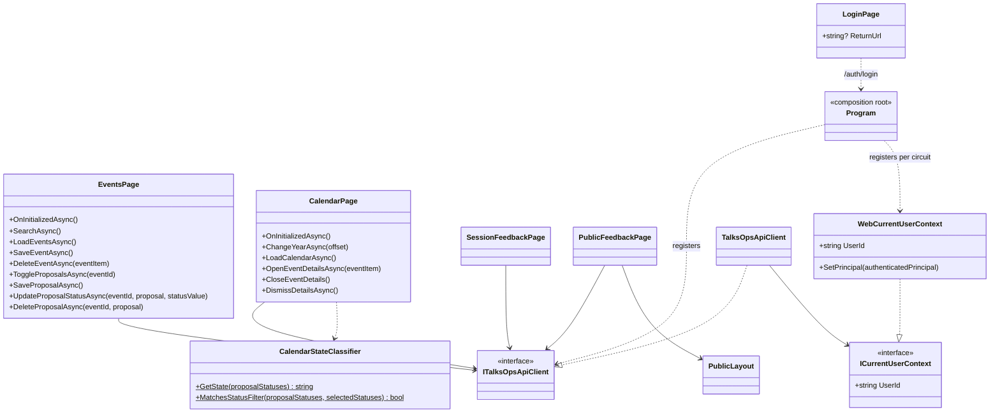

# TalksOps.Web

`TalksOps.Web` is the authenticated server-side Blazor application and backend-for-frontend. It presents event/proposal and session-feedback management plus an annual calendar, and provides an anonymous participant feedback page. The Blazor transport endpoints are anonymous so that page can establish its interactive circuit; `AuthorizeRouteView` continues to protect authenticated routes. It calls the Functions API through `ITalksOpsApiClient`, derives speaker caller IDs from the authenticated principal, and keeps the Function key in server-side configuration.

## Class diagram



## Components and members

Razor component code-behind members are private unless explicitly identified as a component parameter/property.

| Component/type | Properties and methods |
| --- | --- |
| `Events.razor` (`/events`) | Injects `ITalksOpsApiClient Api` and `IJSRuntime JavaScript`. State fields hold event results, search filters, loading/editor state, proposal cache, and success/error messages. The event editor captures optional website and call-for-papers details, including `CallForPapersDeadline`; `OnInitializedAsync` loads events; `SearchAsync` and `LoadEventsAsync` refresh the list; `BeginCreateEvent`/`BeginEditEvent` initialize the event editor; `SaveEventAsync` validates and saves; `DeleteEventAsync` confirms then deletes. `ToggleProposalsAsync` expands/collapses an event and loads its proposals; `BeginCreateProposal`/`BeginEditProposal`, `SaveProposalAsync`, `UpdateProposalStatusAsync`, and `DeleteProposalAsync` manage proposals, including each proposal's optional submission date. `CloseEventEditor` and `CloseProposalEditor` reset editor state. `NullIfEmpty`, `FormatCosts`, and `ParseCosts` normalize filters and display/parse newline-separated `name=amount` costs. |
| `Calendar.razor` (`/calendar`) | Injects `ITalksOpsApiClient Api` and `IJSRuntime JavaScript`. `OnInitializedAsync` loads the current year; `ChangeYearAsync(offset)` changes year within 1–9999 and reloads; `LoadCalendarAsync` fetches and records errors. Proposal-status chips support multi-selection and filter events in each month; clearing all filters restores every event. Each event has an information button opening a read-only native dialog. `OpenEventDetailsAsync(eventItem)` loads the event and all session proposals on demand, with loading, retry, and unavailable-event states. `CloseEventDetails` and `DismissDetailsAsync` clear the selection and invalidate pending responses. `Calendar.razor.js` handles modal focus, Escape and backdrop dismissal; `DisposeAsync` releases interop resources. |
| `CalendarStateClassifier` | Static `GetState(IReadOnlyCollection<string> proposalStatuses)` returns `accepted`, `submitted`, `rejected`, `cancelled`, or `none`, in that precedence order. `MatchesStatusFilter(proposalStatuses, selectedStatuses)` uses OR matching, ignoring case, and matches all events when no statuses are selected. |
| `WebCurrentUserContext` | Scoped implementation of `ICurrentUserContext`. `SetPrincipal(ClaimsPrincipal)` assigns the current Blazor circuit principal. Read-only `UserId` requires an authenticated identity and resolves the first non-blank `preferred_username`, `upn`, or mapped `ClaimTypes.Upn` claim, then trims it and converts it to lowercase invariantly. It throws if no login username is available; subject IDs, display names, and email claims are not fallbacks. |
| `Login.razor` (`/login`) | Public nullable `ReturnUrl` property is bound from the query. Private `ReturnUrlValue` defaults an empty return URL to `/events`; the page is anonymous and starts `/auth/login`. |
| `Home.razor` (`/`) | Authenticated route; `OnInitialized` redirects to `/events`. |
| `SessionFeedback.razor` (`/events/{eventId}/proposals/{proposalId}/feedback`) | Authenticated feedback settings, sharing, results, and JSON transfer page; calls the API only for the owning speaker. `ExportFeedbackAsync` exports transferable feedback; `SelectImportFile` selects a file; `ImportFeedbackAsync` imports it and refreshes the list and summary. |
| `PublicFeedback.razor` (`/feedback/{sessionId}`) | Anonymous participant page using `PublicLayout`; loads availability/title, submits only ratings and comment, and sets SSR status/cache headers for public responses. |

The owner key sent to the API is the login username, not the app-specific `sub`. For example, `Speaker@Example.com` is stored under `events|speaker@example.com`. The `UserId` and `OwnerId` member names remain unchanged for API compatibility. Existing data must be migrated before it is accessible with the new key; see [username ownership migration](../TalksOps.Storage/README.md#username-ownership-migration).

Usernames are mutable and can be reassigned, and they are not guaranteed unique across identity providers or tenants. This ownership scheme requires a trusted account namespace where usernames uniquely identify users and are not recycled. A rename needs another data migration; assigning the same username to another account would give it access to that username's data. For immutable, tenant-scoped ownership, use an explicit account mapping based on `(tid, oid)` instead. Display names and generic email claims are deliberately not accepted as owner keys.

The shared layout, router, error/not-found pages, and static assets are under `Components`. `Counter.razor` and `Weather.razor` are template/demo pages and are not part of the primary TalksOps workflows.

The calendar details dialog shows event location, dates, websites, call-for-papers deadline and itemized costs, followed by every proposal's title, abstract, notes, submission date and current status. Each proposal links to feedback management; the dialog itself does not offer editing or status changes. Details are refreshed on each opening; calendar links and status indicators retain their existing behavior.

Within each month, events with overlapping dates are grouped inside a single red outline, including events sharing only their start/end day and chains of overlapping events. Events spanning multiple months or years appear in each applicable month of the selected year; the outline groups only the events visible in that month. Individual event status borders and proposal indicators are unchanged.

## Session feedback management

The authenticated `/events/{eventId}/proposals/{proposalId}/feedback` page is linked from expanded proposals on Events and each session in the calendar details dialog. The API checks ownership; missing or inaccessible sessions show an unavailable state. Management remains accessible before, during and after the feedback period.

Set start/end local date-times and a named time zone (IANA IDs where supported). Existing UTC instants are displayed in the saved zone. Changing the zone keeps the entered wall times; saving converts them to UTC and requires start before end. Times skipped or repeated by daylight saving are rejected for correction. Saving reloads feedback, which is always shown newest first with UTC timestamps. A failed refresh is explicit and disables export until Refresh succeeds.

Configure `Feedback:PublicBaseUrl` (or `Feedback__PublicBaseUrl`) on the Web server, for example `https://talksops.example.com` or `https://talksops.example.com/app`. The QR encodes this base plus `/feedback/{proposalId}`; it never uses request headers or the browser host. Only absolute HTTP(S) URLs without credentials, query or fragment are accepted. Missing/invalid configuration disables QR download with a visible error but does not block settings or feedback management. QRCoder generates PNG server-side without an external QR service or platform-specific drawing dependency. The participant Web page is implemented separately.

**Export Feedback** exports an array containing only `sessionRating`, `speakerRating`, `comment` and the original `timestamp`, newest first. Empty feedback exports as `[]`. IDs, IP, user-agent and other request metadata are excluded. QR and JSON downloads reuse the existing stream download module, with explicit PNG/JSON MIME types.

To add feedback to this session, select a JSON file (maximum 10 MB) and choose **Import Feedback**. It accepts the same plain array as the export, rather than the versioned event document used on **Import / Export**. Both ratings must be integers from 1 to 10; comments are optional and limited to 4000 characters. For example:

```json
[
  {
    "sessionRating": 8,
    "speakerRating": 9,
    "comment": "Clear and useful.",
    "timestamp": "2026-11-11T09:30:00Z"
  },
  {
    "sessionRating": 7,
    "speakerRating": 8,
    "comment": "Added manually.",
    "timestamp": null
  }
]
```

Supplied timestamps are preserved; an omitted or null `timestamp` uses the server's UTC time at import. All entries needing a timestamp in the same import receive the same instant. Invalid timestamp values are rejected. Imported entries receive new IDs and no participant request metadata. Import appends without replacing existing feedback or changing settings, and remains available outside the collection period or without configured settings. Importing the same file again adds duplicates; an empty array adds no entries.

The page shows the imported count and refreshes the newest-first list, feedback count, and session/speaker rating averages. Controls are disabled while importing, and the file selection is cleared after success. JSON, validation, size, API, and refresh failures are visible. If import succeeds but refresh fails, the success message remains visible and export is disabled until **Refresh** succeeds. Storage writes are not transactional: after an interrupted import, refresh and check existing entries before retrying to avoid duplicates. See the [feedback import API](../TalksOps.Functions/README.md#import-feedback).

## Public participant feedback

`/feedback/{sessionId}` is anonymous, including the initial SSR request under the fallback authorization policy. It uses a separate public layout without account navigation or current-user context. Only the public API's session title is displayed, and only when feedback is available; no speaker details are fetched or shown.

Both whole-number ratings (session and speaker, 1–10) are required and start empty. The comment is optional, with a 4000-character limit. Sending disables the form to prevent concurrent submissions; success replaces it with a confirmation. API validation, size, rate-limit and connection errors are visible and allow retry without clearing the entered values. An unavailable GET or POST removes the title and form and displays the same generic unavailable message.

The API is authoritative for availability: it checks the UTC validity window again on POST, including after reading the body, so an already-open form cannot submit outside the period. An initial unavailable Web request returns **404**, not a successful SSR response with an error message. Public SSR responses use `Cache-Control: no-store`; rendering must remain non-streaming so the availability check finishes before the response starts. Interactive navigation shows the same unavailable state. Public API calls contain no user ID, and any configured Function key remains server-side.

## Import and export

The authenticated `/import-export` page downloads events, sessions, their feedback settings and received feedback as version 1 JSON, optionally filtered by date. **Download JSON template** provides an editable example without needing to select a file. Exports omit event/session/feedback IDs, the settings' internal event reference, IP, user-agent and other request metadata. Import accepts files up to 10 MB, assigns data to the current user, generates new IDs, reconnects settings and feedback to the imported session/event, and never changes existing records. Missing feedback/settings fields and older files containing IDs remain valid; supplied IDs are ignored. See the [Core format and example](../TalksOps.Core/README.md#import-and-export).

## Local configuration and run

Prerequisites: .NET 10 SDK and a running Functions API plus Azurite. `appsettings.Development.json` enables the local fake account by default (`Authentication:UseFakeAccount=true`); it issues a development cookie with a configurable fake ID/name and does not require Microsoft sign-in. The fake ID is also issued as `preferred_username`; sign out and back in after upgrading so existing development cookies receive this claim.

Relevant settings (JSON or environment/user-secrets configuration):

| Setting | Purpose |
| --- | --- |
| `Feedback:PublicBaseUrl` | Absolute public Web base URL used exclusively to build the feedback link and downloadable PNG QR. |
| `TalksOpsApi:BaseAddress` | Functions host base URL; defaults to `http://localhost:7071/`. |
| `TalksOpsApi:FunctionKey` | Optional server-side Function key sent as `x-functions-key`; configure only when the local host requires it. |
| `Features:AiExtraction` | Shows or hides the extraction dropdown beside **New event** on the Events page. Defaults to `false` in both `appsettings.json` and `appsettings.Development.json`; enable it only when the Functions backend is configured for extraction. |
| `Authentication:UseFakeAccount` | Development-only switch for local cookie sign-in. It is honored only in the Development environment. |
| `Authentication:FakeAccountId` / `Authentication:FakeAccountName` | Optional login username and display name for the local fake account. The ID setting retains its name for configuration compatibility. |
| `AzureAd:Instance`, `AzureAd:TenantId`, `AzureAd:ClientId`, `AzureAd:CallbackPath` | OpenID Connect configuration when fake account mode is disabled. Keep client secrets in user secrets or another secret store. |

Set `Features:AiExtraction` to `true` to expose the dropdown beside **New event**, or `false` to keep the manual event workflow only. Choose **Extract from URL** to open a separate call-for-papers URL dialog. A successful extraction closes that dialog and opens a new, unsaved event draft with the extracted values. Invalid URLs and extraction errors stay inside the extraction dialog, preserving the URL for correction or retry. Controls are disabled while extraction is running; **Cancel** dismisses the dialog when idle. The event editor itself does not offer extraction.

For example, use `Features__AiExtraction=true` as an environment variable, or set the value in the appropriate `appsettings` file. The Azure deployment controls the same flag through the `aiExtractionEnabled` parameter in [infra/main.bicep](../../infra/main.bicep), which defaults to `false`.

This flag controls only the Web UI. For local extraction, also configure `FoundryEndpoint`, `FoundryProjectName`, and `FoundryDeploymentName` in the Functions host settings, and sign in with Azure credentials authorized to invoke that Foundry deployment. Without those backend settings, the API returns `Event extraction is not configured.` See [TalksOps.Functions configuration](../TalksOps.Functions/README.md).

Run the Functions API first on port 7071 as described in [TalksOps.Functions](../TalksOps.Functions/README.md). Then run the Web project:

```powershell
dotnet run --launch-profile http
```

Open `http://localhost:5211`. To use different API ports, set `TalksOpsApi:BaseAddress` (for example through `dotnet user-secrets set "TalksOpsApi:BaseAddress" "http://localhost:7147/"`). Never place a production Function key or identity secret in `appsettings*.json` or browser-visible configuration.
