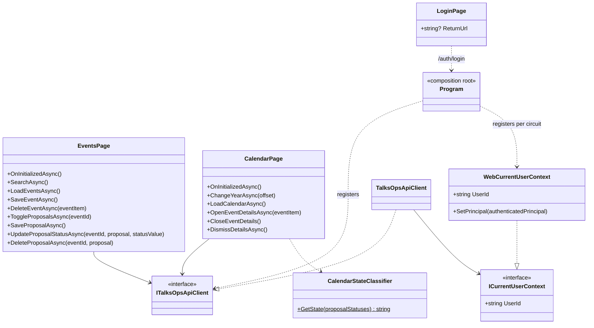

# TalksOps.Web

`TalksOps.Web` is the authenticated server-side Blazor application and backend-for-frontend. It presents event and proposal management plus an annual calendar, calls the Functions API through `ITalksOpsApiClient`, and derives the caller ID from the authenticated principal. The Function key stays in server-side configuration.

## Class diagram



## Components and members

Razor component code-behind members are private unless explicitly identified as a component parameter/property.

| Component/type | Properties and methods |
| --- | --- |
| `Events.razor` (`/events`) | Injects `ITalksOpsApiClient Api` and `IJSRuntime JavaScript`. State fields hold event results, search filters, loading/editor state, proposal cache, and success/error messages. The event editor captures optional website and call-for-papers details, including `CallForPapersDeadline`; `OnInitializedAsync` loads events; `SearchAsync` and `LoadEventsAsync` refresh the list; `BeginCreateEvent`/`BeginEditEvent` initialize the event editor; `SaveEventAsync` validates and saves; `DeleteEventAsync` confirms then deletes. `ToggleProposalsAsync` expands/collapses an event and loads its proposals; `BeginCreateProposal`/`BeginEditProposal`, `SaveProposalAsync`, `UpdateProposalStatusAsync`, and `DeleteProposalAsync` manage proposals. `CloseEventEditor` and `CloseProposalEditor` reset editor state. `NullIfEmpty`, `FormatCosts`, and `ParseCosts` normalize filters and display/parse newline-separated `name=amount` costs. |
| `Calendar.razor` (`/calendar`) | Injects `ITalksOpsApiClient Api` and `IJSRuntime JavaScript`. `OnInitializedAsync` loads the current year; `ChangeYearAsync(offset)` changes year within 1–9999 and reloads; `LoadCalendarAsync` fetches and records errors. Each event has an information button opening a read-only native dialog. `OpenEventDetailsAsync(eventItem)` loads the event and all session proposals on demand, with loading, retry, and unavailable-event states. `CloseEventDetails` and `DismissDetailsAsync` clear the selection and invalidate pending responses. `Calendar.razor.js` handles modal focus, Escape and backdrop dismissal; `DisposeAsync` releases interop resources. |
| `CalendarStateClassifier` | Static `GetState(IReadOnlyCollection<string> proposalStatuses)` returns `accepted`, `submitted`, `rejected`, `cancelled`, or `none`, in that precedence order. |
| `WebCurrentUserContext` | Scoped implementation of `ICurrentUserContext`. `SetPrincipal(ClaimsPrincipal)` assigns the current Blazor circuit principal. Read-only `UserId` resolves the `sub` claim first, then `NameIdentifier`, and throws if unavailable. |
| `Login.razor` (`/login`) | Public nullable `ReturnUrl` property is bound from the query. Private `ReturnUrlValue` defaults an empty return URL to `/events`; the page is anonymous and starts `/auth/login`. |
| `Home.razor` (`/`) | Authenticated route; `OnInitialized` redirects to `/events`. |

The shared layout, router, error/not-found pages, and static assets are under `Components`. `Counter.razor` and `Weather.razor` are template/demo pages and are not part of the primary TalksOps workflows.

The calendar details dialog shows event location, dates, websites, call-for-papers deadline and itemized costs, followed by every proposal's title, abstract, notes, submission date and current status. It does not offer editing or status changes. Details are refreshed on each opening; calendar links and status indicators retain their existing behavior.

## Local configuration and run

Prerequisites: .NET 10 SDK and a running Functions API plus Azurite. `appsettings.Development.json` enables the local fake account by default (`Authentication:UseFakeAccount=true`); it issues a development cookie with a configurable fake ID/name and does not require Microsoft sign-in.

Relevant settings (JSON or environment/user-secrets configuration):

| Setting | Purpose |
| --- | --- |
| `TalksOpsApi:BaseAddress` | Functions host base URL; defaults to `http://localhost:7071/`. |
| `TalksOpsApi:FunctionKey` | Optional server-side Function key sent as `x-functions-key`; configure only when the local host requires it. |
| `Features:AiExtraction` | Shows or hides the extraction dropdown beside **New event** on the Events page. Defaults to `false` in both `appsettings.json` and `appsettings.Development.json`; enable it only when the Functions backend is configured for extraction. |
| `Authentication:UseFakeAccount` | Development-only switch for local cookie sign-in. It is honored only in the Development environment. |
| `Authentication:FakeAccountId` / `Authentication:FakeAccountName` | Optional identity values for the local fake account. |
| `AzureAd:Instance`, `AzureAd:TenantId`, `AzureAd:ClientId`, `AzureAd:CallbackPath` | OpenID Connect configuration when fake account mode is disabled. Keep client secrets in user secrets or another secret store. |

Set `Features:AiExtraction` to `true` to expose the dropdown beside **New event**, or `false` to keep the manual event workflow only. Choose **Extract from URL** to open a separate call-for-papers URL dialog. A successful extraction closes that dialog and opens a new, unsaved event draft with the extracted values. Invalid URLs and extraction errors stay inside the extraction dialog, preserving the URL for correction or retry. Controls are disabled while extraction is running; **Cancel** dismisses the dialog when idle. The event editor itself does not offer extraction.

For example, use `Features__AiExtraction=true` as an environment variable, or set the value in the appropriate `appsettings` file. The Azure deployment controls the same flag through the `aiExtractionEnabled` parameter in [infra/main.bicep](../../infra/main.bicep), which defaults to `false`.

This flag controls only the Web UI. For local extraction, also configure `FoundryEndpoint`, `FoundryProjectName`, and `FoundryDeploymentName` in the Functions host settings, and sign in with Azure credentials authorized to invoke that Foundry deployment. Without those backend settings, the API returns `Event extraction is not configured.` See [TalksOps.Functions configuration](../TalksOps.Functions/README.md).

Run the Functions API first on port 7071 as described in [TalksOps.Functions](../TalksOps.Functions/README.md). Then run the Web project:

```powershell
dotnet run --launch-profile http
```

Open `http://localhost:5211`. To use different API ports, set `TalksOpsApi:BaseAddress` (for example through `dotnet user-secrets set "TalksOpsApi:BaseAddress" "http://localhost:7147/"`). Never place a production Function key or identity secret in `appsettings*.json` or browser-visible configuration.
